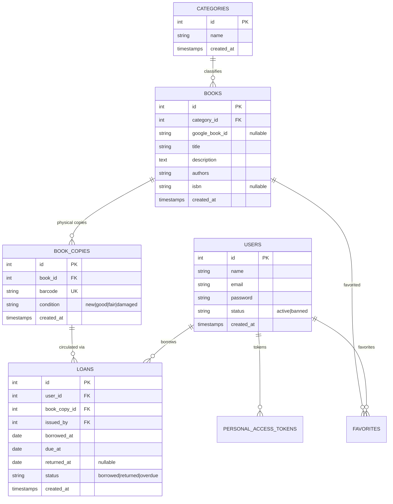

# BookLibraryApp API Documentation (V1)

**Base URL**: `http://localhost:8000/api/v1`  
**Authentication**: Bearer Token via Laravel Sanctum  
`Authorization: Bearer <your_access_token>`

---

## Table of Contents
1. [Architecture & Database ERD](#1-architecture--database-erd)
2. [Authentication & Profile APIs](#2-authentication--profile-apis)
3. [User & Role Management APIs](#3-user--role-management-apis)
4. [Categories & Books Catalog APIs](#4-categories--books-catalog-apis)
5. [Book Copies, Inventory & Barcodes](#5-book-copies-inventory--barcodes)
6. [Loans & Circulation APIs](#6-loans--circulation-apis)
7. [Google Books API Integration](#7-google-books-api-integration)
8. [Gemini AI Integration](#8-gemini-ai-integration)
9. [Dashboard Statistics & Circulation Charts](#9-dashboard-statistics--circulation-charts)
10. [Standard HTTP Status Codes & Error Responses](#10-standard-http-status-codes--error-responses)
11. [cURL Quick Reference for Core Workflows](#11-curl-quick-reference-for-core-workflows)
12. [Postman / API Client Setup](#12-postman--api-client-setup)

---

## 1. Architecture & Database ERD



---

## 2. Authentication & Profile APIs

### Register New User
- **Endpoint**: `POST /api/v1/register`
- **Access**: Public
- **Request Body**:
```json
{
  "name": "Jane Doe",
  "email": "jane@example.com",
  "password": "Password123!",
  "password_confirmation": "Password123!"
}
```
- **Response (201 Created)**:
```json
{
  "message": "User registered successfully.",
  "access_token": "1|e4g...",
  "token_type": "Bearer",
  "user": {
    "id": 1,
    "name": "Jane Doe",
    "email": "jane@example.com",
    "status": "active"
  }
}
```

### User Login
- **Endpoint**: `POST /api/v1/login`
- **Access**: Public
- **Request Body**:
```json
{
  "email": "jane@example.com",
  "password": "Password123!"
}
```
- **Response (200 OK)**:
```json
{
  "message": "Login successful.",
  "access_token": "2|k9a...",
  "token_type": "Bearer",
  "user": {
    "id": 1,
    "name": "Jane Doe",
    "email": "jane@example.com"
  }
}
```

### Logout
- **Endpoint**: `POST /api/v1/logout`
- **Access**: Authenticated (`Bearer <token>`)
- **Response (200 OK)**:
```json
{
  "message": "Successfully logged out."
}
```

### Get Current User Profile
- **Endpoint**: `GET /api/v1/me` (or `GET /api/v1/user`)
- **Access**: Authenticated

---

## 3. User & Role Management APIs

| Method | Endpoint | Description |
|---|---|---|
| `GET` | `/api/v1/users` | List users (paginated, with search & role filters) |
| `GET` | `/api/v1/users/{id}` | View single user details |
| `PUT` | `/api/v1/users/{id}` | Update user name, email, or active/banned status |
| `DELETE` | `/api/v1/users/{id}` | Delete user (`400` if self-deletion or active unreturned loans) |
| `GET` | `/api/v1/roles` | List all system roles (`admin`, `librarian`, `member`) |
| `POST` | `/api/v1/roles` | Create new role (Admin only) |
| `GET` | `/api/v1/permissions` | List all available permissions (Admin only) |
| `POST` | `/api/v1/users/{id}/roles` | Assign roles to a user (Admin only) |
| `POST` | `/api/v1/users/{id}/permissions` | Assign direct permissions to a user (Admin only) |

---

## 4. Categories & Books Catalog APIs

### Categories CRUD (by ID)
- `GET /api/v1/categories`: List categories with book counts
- `POST /api/v1/categories`: Create category (`{"name": "Computer Science"}`)
- `GET /api/v1/categories/{id}`: View category details
- `PUT/PATCH /api/v1/categories/{id}`: Update category name
- `DELETE /api/v1/categories/{id}`: Delete category

### Books CRUD (by ID)
- `GET /api/v1/books`: List books with optional `search` and `category_id` query filters
- `POST /api/v1/books`: Create book
```json
{
  "title": "Clean Code",
  "category_id": 1,
  "authors": "Robert C. Martin",
  "isbn": "9780132350884",
  "description": "A handbook of agile software craftsmanship.",
  "google_book_id": "google_123"
}
```
- `GET /api/v1/books/{id}`: View single book details
- `PUT/PATCH /api/v1/books/{id}`: Update book
- `DELETE /api/v1/books/{id}`: Delete book

---

## 5. Book Copies, Inventory & Barcodes

### Book Copies Endpoints
- `GET /api/v1/book-copies`: List copies (query params: `book_id`, `status=available|borrowed`, `condition`, `barcode`, `search`)
- `POST /api/v1/book-copies`: Create single copy (auto-generates `LIB-XXXXXXXX` barcode if left blank)
- `POST /api/v1/book-copies/bulk`: Bulk-create copies:
```json
{
  "book_id": 1,
  "count": 5,
  "condition": "new",
  "prefix": "TECH"
}
```
- `POST /api/v1/books/{id}/copies`: Add copies directly to a specific book
- `GET /api/v1/book-copies/barcode/{barcode}`: Scan copy by barcode
- `GET /api/v1/book-copies/{id}`: Get copy details
- `GET /api/v1/book-copies/{id}/barcode`: Printable barcode label payload (CODE128 standard)
- `PUT/PATCH /api/v1/book-copies/{id}`: Update copy condition or barcode
- `DELETE /api/v1/book-copies/{id}`: Delete copy (`409 Conflict` if copy is borrowed or has loan history)

### Inventory Endpoints
- `GET /api/v1/inventory`: Complete inventory dashboard with summary metrics and paginated books
- `GET /api/v1/inventory/summary`: Fast aggregate metrics (`total_books`, `total_copies`, `available_copies`, `borrowed_copies`, `overdue_copies`, `condition_breakdown`)
- `GET /api/v1/books/{id}/inventory`: Single book inventory tracking (total copies, available copies, condition breakdown, copies list)

---

## 6. Loans & Circulation APIs

### Borrow a Book Copy
- **Endpoint**: `POST /api/v1/loans` (or `POST /api/v1/borrow`)
- **Request Body**:
```json
{
  "book_copy_id": 1,
  "user_id": 2,
  "borrowed_at": "2026-11-04",
  "due_at": "2026-11-18"
}
```
- **Validation**: Fails with `422` if copy is already borrowed by another user or if borrower account is inactive/banned.

### Return a Book Copy
- **Endpoint**: `POST /api/v1/loans/{id}/return` (or `POST /api/v1/return/{id}`)
- **Request Body**:
```json
{
  "returned_at": "2026-11-04"
}
```

### Overdue & User Loans
- `GET /api/v1/loans`: List all loans (filters: `status`, `user_id`, `book_copy_id`, `search`)
- `GET /api/v1/loans/overdue`: List currently past-due unreturned loans
- `GET /api/v1/loans/my-loans`: View authenticated user's loan history

---

## 7. Google Books API Integration

### Search Books Online
- **Endpoint**: `GET /api/v1/google-books/search?q={searchTerm}&max_results={limit}`
- **Response (200 OK)**:
```json
{
  "total_items": 120,
  "items": [
    {
      "google_book_id": "abc123xyz",
      "title": "Refactoring",
      "authors": "Martin Fowler",
      "description": "Improving the design of existing code...",
      "isbn": "9780134757599",
      "categories": ["Computers"],
      "page_count": 448,
      "thumbnail": "https://books.google.com/..."
    }
  ]
}
```

### View Single Google Volume
- **Endpoint**: `GET /api/v1/google-books/{googleBookId}`

### Import Book Directly to Catalog
- **Endpoint**: `POST /api/v1/google-books/import`
- **Request Body**:
```json
{
  "google_book_id": "abc123xyz",
  "category_id": null,
  "copies_count": 3,
  "condition": "new"
}
```
- **Behavior**: Auto-creates the category if omitted, creates/updates the book, and generates physical copies with barcodes automatically.

---

## 8. Gemini AI Integration

### AI Book Recommendations
- **Endpoint**: `POST /api/v1/ai/recommendations`
- **Request Body**:
```json
{
  "preferences": "Distributed systems, microservices, and high-performance databases"
}
```
- **Response (200 OK)**:
```json
{
  "user_id": 1,
  "based_on_history": true,
  "recommendations": [
    {
      "title": "Designing Data-Intensive Applications",
      "author": "Martin Kleppmann",
      "genre": "System Design",
      "reason": "Perfect match for your interest in distributed databases."
    }
  ]
}
```

### AI Book Synopsis & Analysis
- **Endpoint**: `POST /api/v1/ai/summarize/{id}`
- **Response (200 OK)**:
```json
{
  "book_id": 1,
  "title": "Clean Architecture",
  "synopsis": "Comprehensive explanation of boundaries, entities, and use cases...",
  "key_themes": ["Clean Code", "Decoupling", "Software Architecture"],
  "target_audience": "Software architects, senior developers, and technical leads",
  "difficulty_level": "Intermediate"
}
```

### Conversational AI Library Assistant
- **Endpoint**: `POST /api/v1/ai/chat`
- **Request Body**:
```json
{
  "message": "Do you have any recommendations for beginners learning Python?",
  "history": [
    {"role": "user", "content": "Hello!"},
    {"role": "assistant", "content": "Welcome to the library! How can I help you today?"}
  ]
}
```
- **Response (200 OK)**:
```json
{
  "reply": "We have several great Python books available, such as 'Automate the Boring Stuff with Python'..."
}
```

---

## 9. Dashboard Statistics & Circulation Charts

### Overview Statistics
- **Endpoint**: `GET /api/v1/dashboard/stats`
- **Response (200 OK)**:
```json
{
  "summary": {
    "total_books": 42,
    "total_copies": 150,
    "available_copies": 128,
    "borrowed_copies": 22,
    "total_users": 65,
    "active_borrowers": 18,
    "total_loans": 310,
    "active_loans": 22,
    "overdue_loans": 3,
    "returned_loans": 288,
    "return_rate_percentage": 92.9
  },
  "breakdowns": {
    "copies_by_condition": {
      "new": 50,
      "good": 80,
      "fair": 15,
      "damaged": 5
    },
    "loans_by_status": {
      "borrowed": 19,
      "overdue": 3,
      "returned": 288
    },
    "top_categories": [
      {"id": 1, "name": "Software Engineering", "books_count": 18},
      {"id": 2, "name": "Data Science", "books_count": 12}
    ]
  }
}
```

### Popular Books
- **Endpoint**: `GET /api/v1/dashboard/popular-books` (top 10 most borrowed books)

### Recent Circulation Activities
- **Endpoint**: `GET /api/v1/dashboard/recent-activities` (latest 10 borrowings and returns)

### 14-Day Circulation Charts
- **Endpoint**: `GET /api/v1/dashboard/charts` (daily borrowed vs. returned volume)

---

## 10. Standard HTTP Status Codes & Error Responses

| Status Code | Meaning | Usage |
|---|---|---|
| `200 OK` | Successful request | Fetch, update, search, AI generation |
| `201 Created` | Resource created | Registration, book creation, loan issued, import |
| `204 No Content` | Success, no body | Deletions |
| `400 Bad Request` | Invalid operation | Self-deletion, borrowing while banned |
| `401 Unauthorized` | Missing/invalid token | Unauthenticated requests |
| `403 Forbidden` | Insufficient permissions | Role/permission authorization failures |
| `404 Not Found` | Resource not found | Invalid book/copy/user ID or barcode |
| `409 Conflict` | Conflict with state | Deleting copies or users with active loans |
| `422 Unprocessable` | Validation error | Missing required fields, unique constraint clashes |
| `500 Server Error` | External service error | External Google/Gemini API failure |

---

## 11. cURL Quick Reference for Core Workflows

### 1. Register & Login
```bash
# Register
curl -X POST http://localhost:8000/api/v1/register \
  -H "Content-Type: application/json" \
  -H "Accept: application/json" \
  -d '{"name": "Alice Reader", "email": "alice@example.com", "password": "Password123!", "password_confirmation": "Password123!"}'

# Login
curl -X POST http://localhost:8000/api/v1/login \
  -H "Content-Type: application/json" \
  -H "Accept: application/json" \
  -d '{"email": "alice@example.com", "password": "Password123!"}'
```

### 2. Add Book & Copies
```bash
# Create Book
curl -X POST http://localhost:8000/api/v1/books \
  -H "Authorization: Bearer <TOKEN>" \
  -H "Content-Type: application/json" \
  -H "Accept: application/json" \
  -d '{"title": "Clean Architecture", "category_id": 1, "authors": "Robert C. Martin", "isbn": "9780134494166"}'

# Add 3 Physical Copies with Auto-Generated Barcodes
curl -X POST http://localhost:8000/api/v1/books/1/copies \
  -H "Authorization: Bearer <TOKEN>" \
  -H "Content-Type: application/json" \
  -H "Accept: application/json" \
  -d '{"count": 3, "condition": "new"}'

# Scan by Barcode
curl -X GET http://localhost:8000/api/v1/book-copies/barcode/LIB-A1B2C3D4 \
  -H "Authorization: Bearer <TOKEN>" \
  -H "Accept: application/json"
```

### 3. Borrowing & Returning
```bash
# Borrow Copy
curl -X POST http://localhost:8000/api/v1/loans \
  -H "Authorization: Bearer <TOKEN>" \
  -H "Content-Type: application/json" \
  -H "Accept: application/json" \
  -d '{"book_copy_id": 1, "user_id": 1}'

# Return Copy
curl -X POST http://localhost:8000/api/v1/loans/1/return \
  -H "Authorization: Bearer <TOKEN>" \
  -H "Content-Type: application/json" \
  -H "Accept: application/json" \
  -d '{"returned_at": "2026-11-04"}'
```

### 4. Google Books & Gemini AI
```bash
# Search Google Books
curl -X GET "http://localhost:8000/api/v1/google-books/search?q=Domain-Driven+Design" \
  -H "Authorization: Bearer <TOKEN>" \
  -H "Accept: application/json"

# Import Google Volume to Catalog
curl -X POST http://localhost:8000/api/v1/google-books/import \
  -H "Authorization: Bearer <TOKEN>" \
  -H "Content-Type: application/json" \
  -H "Accept: application/json" \
  -d '{"google_book_id": "s1gVAAAAYAAJ", "copies_count": 2}'

# Ask Gemini AI Librarian
curl -X POST http://localhost:8000/api/v1/ai/chat \
  -H "Authorization: Bearer <TOKEN>" \
  -H "Content-Type: application/json" \
  -H "Accept: application/json" \
  -d '{"message": "Can you recommend a good beginner book on database architecture?"}'
```

### 5. Dashboard KPIs
```bash
curl -X GET http://localhost:8000/api/v1/dashboard/stats \
  -H "Authorization: Bearer <TOKEN>" \
  -H "Accept: application/json"
```

---

## 12. Postman / API Client Setup

1. **Base URL**: Set environment variable `baseUrl` to `http://localhost:8000/api/v1`.
2. **Bearer Token Authentication**:
   - In Postman, select your Collection or Folder root.
   - Go to the **Authorization** tab.
   - Select Type: **Bearer Token**.
   - Set Token to `{{accessToken}}`.
   - In the **Login** request Tests script, store the token automatically:
     ```javascript
     const jsonData = pm.response.json();
     if (jsonData.access_token) {
         pm.environment.set("accessToken", jsonData.access_token);
     }
     ```
3. **Headers Required on All Requests**:
   ```
   Accept: application/json
   Content-Type: application/json
   ```


