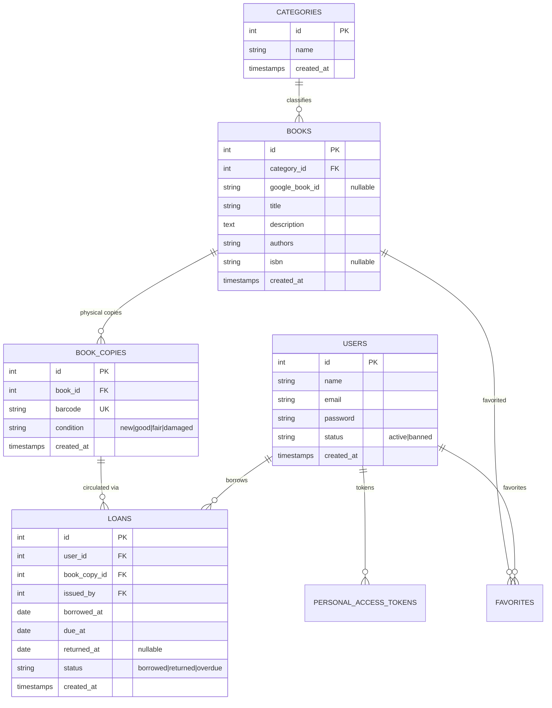

# 📚 Book Library Management System (BookLibraryApp-Y3-S1)

A full-featured, enterprise-grade RESTful Library Management API built with **Laravel 13**, **PHP 8.5**, **PostgreSQL/MySQL**, and **Laravel Sanctum**. Incorporates barcode inventory operations, circulation rules, Google Books API synchronization, Google Gemini AI assistant, and comprehensive analytics.

---

## 🚀 Key Highlights & Milestone Matrix

| Milestone | Scope & Capabilities | Status |
| :--- | :--- | :---: |
| **Milestone 1** | **Database Architecture & Models**: Schema migrations, Entity-Relationship Diagram (ERD), Eloquent relationships (`hasMany`, `belongsTo`, `hasManyThrough`, `belongsToMany`), factories, and seeders. | ✅ Completed |
| **Milestone 2** | **Auth, Catalog & RBAC**: Sanctum Bearer token authentication, Books & Categories CRUD (explicit routes by ID), Role-Based Access Control (`admin`, `librarian`, `member`), permission gates, and strict FormRequest validation. | ✅ Completed |
| **Milestone 3** | **Circulation & Inventory**: User management, physical copy tracking (`BookCopy`), auto-generating unique barcodes (`LIB-XXXXXXXX`), barcode scanning & CODE128 printable label payloads, inventory stock reports, borrowing/returns, and automated overdue tracking. | ✅ Completed |
| **Milestone 4** | **Integrations, AI & Analytics**: Google Books API integration (volume search, metadata sync & 1-click catalog import), Gemini AI integration (personalized book recommendations, synopsis summarizer & library chatbot assistant), dashboard KPIs, and circulation trends. | ✅ Completed |

**Test Suite Coverage**: **116 Tests / 650 Assertions** passing with 100% success rate.

---

## 🛠️ Tech Stack & Requirements

- **PHP**: `^8.3` (Developed & tested on `PHP 8.5.12`)
- **Framework**: `Laravel 13.x`
- **Authentication**: `Laravel Sanctum 4.x` (Bearer Token)
- **Database**: PostgreSQL (production/local), SQLite in-memory (testing)
- **Integrations**:
  - Google Books API v1
  - Google Gemini API (`gemini-1.5-flash`)
- **Code Standards**: PSR-12 formatted with **Laravel Pint**
- **Test Runner**: PHPUnit 12.x

---

## 📐 Database Entity Relationship Diagram (ERD)



---

## ⚙️ Quick Start Installation

### 1. Clone & Install Dependencies
```bash
git clone https://github.com/your-username/BookLibraryApp-Y3-S1.git
cd BookLibraryApp-Y3-S1
composer install
```

### 2. Configure Environment
Copy `.env.example` to `.env`:
```bash
cp .env.example .env
php artisan key:generate
```

Configure your database connection in `.env`:
```env
DB_CONNECTION=pgsql
DB_HOST=127.0.0.1
DB_PORT=5432
DB_DATABASE=book_library
DB_USERNAME=postgres
DB_PASSWORD=your_password

# Optional: Add external API keys for Milestone 4 features
GOOGLE_BOOKS_API_KEY=
GEMINI_API_KEY=your_gemini_api_key_here
```

### 3. Run Migrations and Seeders
```bash
php artisan migrate --seed
```

### 4. Start Local Development Server
```bash
php artisan serve
```
The API is accessible at: `http://localhost:8000/api/v1`

---

## 🧪 Running Automated Tests

Run the complete test suite (116 tests, 650 assertions):
```bash
vendor/bin/phpunit --testdox
```

Run test suite for a specific feature:
```bash
vendor/bin/phpunit --filter=BookCopyApiTest
vendor/bin/phpunit --filter=GoogleBooksApiTest
vendor/bin/phpunit --filter=GeminiAiApiTest
vendor/bin/phpunit --filter=DashboardApiTest
```

Format code according to Laravel standards:
```bash
vendor/bin/pint --format agent
```

---

## 📖 API Documentation Reference

For the comprehensive endpoint catalog, sample JSON requests, and cURL commands, see:
👉 [**API_DOCUMENTATION.md**](./API_DOCUMENTATION.md)

### Core Route Summary (`/api/v1`)

```
Authentication:
  POST   /api/v1/register
  POST   /api/v1/login
  POST   /api/v1/logout
  GET    /api/v1/me

Catalog & Categories:
  GET    /api/v1/categories
  POST   /api/v1/categories
  GET    /api/v1/categories/{id}
  PUT    /api/v1/categories/{id}
  DELETE /api/v1/categories/{id}
  GET    /api/v1/books
  POST   /api/v1/books
  GET    /api/v1/books/{id}
  PUT    /api/v1/books/{id}
  DELETE /api/v1/books/{id}

Copies & Inventory:
  GET    /api/v1/book-copies
  POST   /api/v1/book-copies
  POST   /api/v1/book-copies/bulk
  GET    /api/v1/book-copies/barcode/{barcode}
  GET    /api/v1/book-copies/{id}
  GET    /api/v1/book-copies/{id}/barcode
  PUT    /api/v1/book-copies/{id}
  DELETE /api/v1/book-copies/{id}
  POST   /api/v1/books/{id}/copies
  GET    /api/v1/inventory
  GET    /api/v1/inventory/summary
  GET    /api/v1/books/{id}/inventory

Circulation & Loans:
  GET    /api/v1/loans
  POST   /api/v1/loans (or /borrow)
  GET    /api/v1/loans/overdue
  GET    /api/v1/loans/my-loans
  GET    /api/v1/loans/{id}
  POST   /api/v1/loans/{id}/return (or /return/{id})
  DELETE /api/v1/loans/{id}

Google Books Integration:
  GET    /api/v1/google-books/search
  GET    /api/v1/google-books/{googleBookId}
  POST   /api/v1/google-books/import

Gemini AI Integration:
  POST   /api/v1/ai/recommendations
  POST   /api/v1/ai/summarize/{id}
  POST   /api/v1/ai/chat

Dashboard Analytics:
  GET    /api/v1/dashboard/stats
  GET    /api/v1/dashboard/popular-books
  GET    /api/v1/dashboard/recent-activities
  GET    /api/v1/dashboard/charts

Role & Permission Admin:
  GET    /api/v1/roles
  POST   /api/v1/roles
  GET    /api/v1/permissions
  POST   /api/v1/users/{id}/roles
  POST   /api/v1/users/{id}/permissions
```

---

## 🔒 Security & Access Control

- **Token Authentication**: Secured using Sanctum Bearer tokens.
- **Route Validation**: Strict parameter filtering and `{id}` integer constraints prevent SQL injection and route collisions.
- **State Guarding**: Copies and users with active borrowings cannot be deleted, returning `400 Bad Request` or `409 Conflict`.
- **Role Enforcement**: Administrative features (role assignment, permission grants) are restricted to the `admin` role via middleware.

---

## 📄 License
This project is open-sourced software licensed under the [MIT License](LICENSE).
